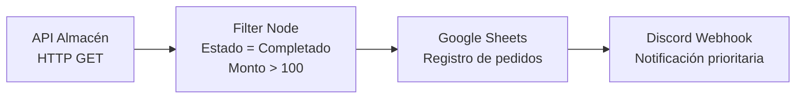

# Automatización de Pedidos con n8n

## Resumen ejecutivo

Este proyecto demuestra cómo automatizar el procesamiento de pedidos entrantes usando **n8n** para reducir trabajo manual y mejorar los tiempos de respuesta del equipo.

El flujo obtiene pedidos desde una API de almacén, filtra únicamente los pedidos relevantes (por ejemplo, estado `Completado` y monto alto), registra la información para trazabilidad y notifica automáticamente por Discord solo los casos prioritarios.

### Valor que aporta

- Disminuye el tiempo de revisión manual de pedidos.
- Estandariza criterios de priorización.
- Centraliza el registro operativo en una fuente de datos (ej. Google Sheets).
- Acelera la comunicación interna con alertas automatizadas.

## Arquitectura del flujo

> Si prefieres un diagrama visual alternativo, puedes sustituir esta sección por una imagen en `./assets/architecture.png`.

## Requisitos previos

Antes de importar y ejecutar el flujo, asegúrate de tener:

1. **n8n** instalado (Cloud o self-hosted).
2. Acceso a la API de origen de pedidos.
3. Un webhook de Discord para el canal destino.
4. Una hoja de cálculo en Google Sheets (opcional, si deseas persistencia).

## Cómo importar el JSON en n8n (paso a paso)

1. Exporta o descarga el archivo del workflow (por ejemplo: `workflow-pedidos.json`).
2. En n8n, entra a **Workflows**.
3. Haz clic en **Import from file** (o **Import from URL**, según tu entorno).
4. Selecciona el JSON del flujo.
5. Revisa los nodos importados y valida que no existan errores de credenciales.
6. Configura las credenciales necesarias (ver sección siguiente).
7. Ejecuta el flujo en modo prueba (**Execute Workflow**) para validar datos.
8. Activa el workflow con el switch **Active**.

## Variables de entorno y credenciales

Configura las credenciales en n8n **sin exponer secretos en el repositorio**:

- `WAREHOUSE_API_URL`: URL base de la API del almacén.
- `WAREHOUSE_API_TOKEN`: token de autenticación para la API.
- `DISCORD_WEBHOOK_URL`: URL del webhook del canal de Discord.
- `GOOGLE_SHEETS_CREDENTIALS` (si aplica): credencial OAuth/Service Account para Sheets.
- `GOOGLE_SHEET_ID` (si aplica): ID de la hoja donde se registran pedidos.

### Buenas prácticas de seguridad

- Usa el gestor de credenciales de n8n para tokens y secretos.
- No subas `.env` ni claves privadas al repositorio.
- Comparte ejemplos con valores ficticios (por ejemplo `YOUR_TOKEN_HERE`).

## Captura de pantalla

## Licencia

Este proyecto se distribuye bajo la licencia MIT.
