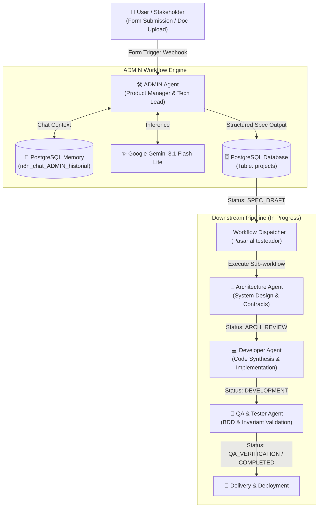

# Autonomous Software Development Team - Pipeline Architecture

## System Overview

This project implements an autonomous AI multi-agent software engineering squad inside **n8n**. The pipeline automates the complete Software Development Life Cycle (SDLC) starting from raw project ideas and documentation up to testing and deployment.

---

## Architectural Workflow Diagram

---

## State Machine Lifecycle

Each project record in PostgreSQL traverses the following discrete states:

| State | Responsible Agent / Step | Description |
| :--- | :--- | :--- |
| `SPEC_DRAFT` | **ADMIN (Tech Lead)** | Raw idea or document converted to formal SDD contract JSON. |
| `ARCH_REVIEW` | **Architect Agent** | Technical blueprint, stack choices, and microservice definitions created. |
| `DEVELOPMENT` | **Developer Agent** | Code generation according to specification and Design by Contract invariants. |
| `QA_VERIFICATION` | **Tester Agent** | Automated test suite execution, BDD verification, and invariant compliance checks. |
| `COMPLETED` | **Pipeline Orchestrator** | Verified deliverables ready for pull request or production release. |

---

## Node Details in `ADMIN.json`

1. **`Archivo de proyecto` (`n8n-nodes-base.formTrigger`)**:
   - Provides web-based intake for stakeholders to submit project requirements, uploaded documents, and architectural constraints.
2. **`AI Agent` (`@n8n/n8n-nodes-langchain.agent`)**:
   - Acts as the Senior PM and Tech Lead.
   - Enforces SDD / DbC formatting in strict JSON format.
3. **`Modelo IA` (`@n8n/n8n-nodes-langchain.lmChatGoogleGemini`)**:
   - Connected to `models/gemini-3.1-flash-lite`.
4. **`MEMORIA` (`@n8n/n8n-nodes-langchain.memoryPostgresChat`)**:
   - Maintains chat history across iterations in `n8n_chat_ADMIN_historial` keyed by execution ID.
5. **`guardar SDD` (`n8n-nodes-base.postgres`)**:
   - Upserts project record into `projects` table with initial state `SPEC_DRAFT`.
6. **`Pasar al testeador` (`n8n-nodes-base.executeWorkflow`)**:
   - Calls the next workflow in the pipeline (`pt7VA4G5OSWc711z`).
