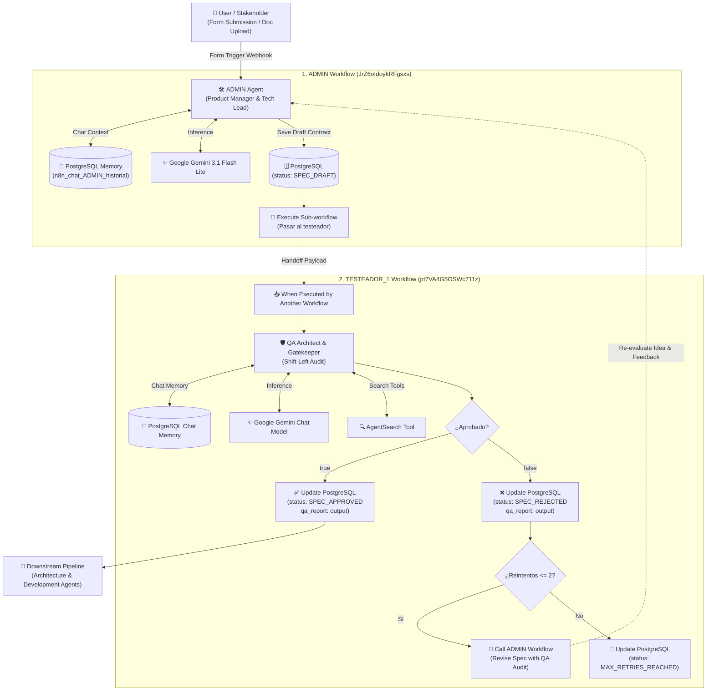

# Autonomous Software Development Team - Pipeline Architecture

## System Overview

This project implements an autonomous AI multi-agent software engineering squad inside **n8n**. The pipeline automates the complete Software Development Life Cycle (SDLC) starting from raw project ideas and documentation up to testing and deployment.

---

## Architectural Workflow Diagram

---

## State Machine Lifecycle

Each project record in PostgreSQL traverses the following discrete states:

| State | Responsible Agent / Step | Description |
| :--- | :--- | :--- |
| `SPEC_DRAFT` | **ADMIN (Tech Lead)** | Raw idea or document converted to formal SDD contract JSON. |
| `SPEC_APPROVED` | **TESTEADOR_1 (QA Gatekeeper)** | SDD contract successfully passes all 4 audit pillars (Score >= 75, 0 critical invariant flaws). |
| `SPEC_REJECTED` | **TESTEADOR_1 (QA Gatekeeper)** | SDD fails audit requirements; triggers feedback revision loop back to ADMIN. |
| `MAX_RETRIES_REACHED` | **TESTEADOR_1 (Orchestrator)** | Revision attempts exceed threshold without reaching consensus. Flagged for human review. |
| `ARCH_REVIEW` | **Architect Agent** | Technical blueprint, stack choices, and microservice definitions created. |
| `DEVELOPMENT` | **Developer Agent** | Code generation according to specification and Design by Contract invariants. |
| `QA_VERIFICATION` | **Tester Agent** | Automated test suite execution, BDD verification, and invariant compliance checks. |
| `COMPLETED` | **Pipeline Orchestrator** | Verified deliverables ready for pull request or production release. |

---

## The 4 Audit Pillars (Shift-Left Testing)

1. **Invariants (DbC)**: Verifies that data integrity, authentication, and state immutability are unbreakable.
2. **BDD Behavior (Sad Paths)**: Audits edge cases, timeouts, invalid payloads, and security injection defenses beyond the standard happy path.
3. **Requirements Feasibility**: Validates rate limits, network timeouts, response SLAs, and architectural feasibility.
4. **Acceptance Criteria**: Enforces binary, programmatically auditable checkboxes for downstream testing suites.
